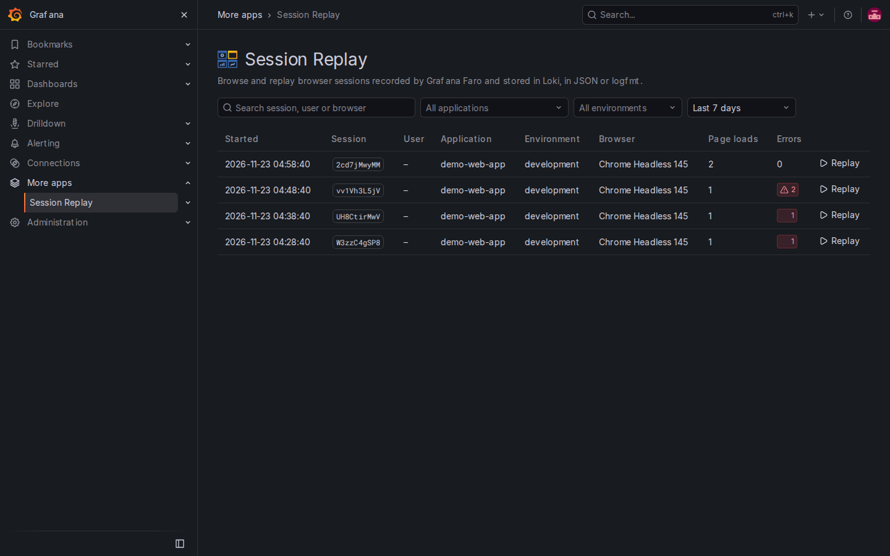
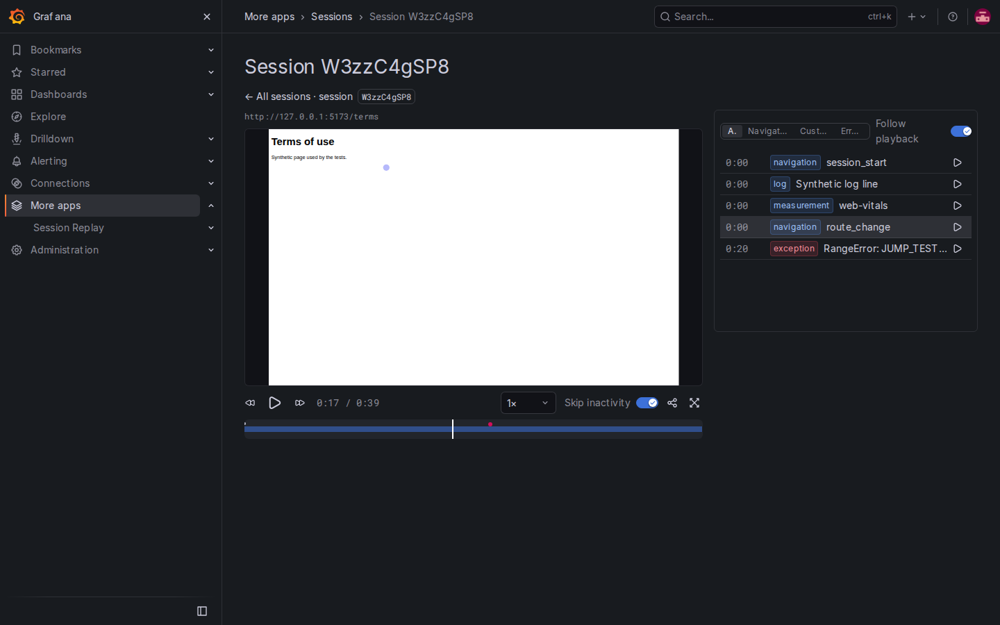

# Session Replay for Grafana (escalia-sessionreplay-app)

A Grafana app plugin that lists and replays browser sessions recorded by
[Grafana Faro](https://grafana.com/oss/faro/)'s replay instrumentation and stored
in Loki. It reads the lines in **JSON** or **logfmt**, and opens a session at a
given moment so a dashboard can link straight to an error.





The screenshots use synthetic demo data.

- Frontend only. It queries Loki through Grafana (`/api/ds/query`), so datasource
  permissions apply. It stores nothing and writes nothing.
- Pages need the **Editor** role: recordings can show personal data.
- Grafana 13.2 or newer. Faro replay 2.13 or newer (one recording id per tab,
  `gen` counted per restart).

## What it does

- **Sessions**: recorded sessions in a time range, filter by application,
  environment and text, error count per session (counted by Loki).
- **Replay**: timeline of the recorded time (gaps are skipped), play, pause,
  ±10 s, speed, skip inactivity, fullscreen, share a link to the current moment.
- **Journey**: navigations, logs, exceptions, events and measurements of the
  session beside the player, with filters, jump to an event and follow playback.
- **Deep links**: `/a/escalia-sessionreplay-app/session/<sessionId>?t=<ms>`.

### The `t` parameter

`t` is milliseconds on the **browser clock since the start of the session**,
counting the time between recorded parts. A dashboard computes it from two
timestamps: `t = errorTime − firstRecordingTime − 3000`. A value that falls in a
gap opens at the start of the next recorded part; a negative one opens at the
start. `from` and `to` (epoch ms, Loki time) can bound the queries.

## Settings

_Administration → Plugins → Session Replay → Configuration_, or provisioning:

| Setting           | Meaning                                                                | Default                     |
| ----------------- | ---------------------------------------------------------------------- | --------------------------- |
| `lokiUid`         | Uid of the Loki datasource.                                            | `loki`                      |
| `selector`        | LogQL stream selector for the Faro lines. Only text filters follow it. | `{service_name="frontend"}` |
| `format`          | `json` or `logfmt`.                                                    | `json`                      |
| `clockPadSeconds` | Seconds added around a recorded part when reading Loki.                | `30`                        |

The plugin never needs a `kind`, `replay` or `source` label: it filters by text
(`|= "faro.session_recording.event"`) and parses the lines itself.

## Loki requirements

- Accept long lines: a snapshot of the page can reach hundreds of KB to several
  MB (`limits_config.max_line_size`).
- `max_entries_limit_per_query` of 5 000 or more (the plugin asks for 5 000 per
  query and pages through the rest).
- Retention is Loki's: the plugin does not delete anything.

## Privacy

Recordings are masked in the **browser** by the recording application. Neither
Loki nor this plugin sanitizes anything, and anyone who may read the Loki
datasource and holds the Editor role can watch the sessions. The replayed page
may load its own assets (stylesheets, images, fonts) from the recorded
application, as it would for any visitor; the plugin itself only calls Grafana.
Grafana's `content_security_policy` also applies to the replay frame if you want
to forbid that.

## Develop

```bash
npm ci
npm run dev            # build and watch
npm run server         # Grafana 13.3 + Loki on 127.0.0.1:13000 / :13100 (tests/stack)
npm run fixtures:push  # push the fixture sessions to that Loki (JSON shape; logfmt.spec.ts pushes its own)
npm run test:ci        # unit tests (synthetic Faro sessions, or your local recordings)
npm run e2e            # Playwright against that stack (also covers logfmt)
npm run lint && npm run typecheck
npm run package        # release/<id>-<version>.zip and .sha256 (unsigned)
```

The tests read Faro sessions from `tests/fixtures/{logfmt,json}` when you have local recordings
(not published), and otherwise from synthetic sessions that `scripts/make-synthetic.mjs`
generates into `tests/synthetic/` (what CI uses). Record your own with a Faro-instrumented app
(`scripts/record-session.mjs`) and export them with `scripts/export-fixtures.py`. The synthetic
sessions are time-relative, so reset the test stack (`npm run server:down`, then `npm run server`)
before pushing them again, or the sessions would be duplicated in Loki.

## Use it in a separate environment

`npm run env:up` starts Grafana, Loki and Alloy on their own (127.0.0.1 only: Grafana
`:14000`, Alloy's Faro receiver `:14347`, Loki `:14100`), installs the plugin **from
the release zip** and generates the admin password and the Faro key
(`scripts/env.sh secrets`). Then:

1. Serve a Faro-instrumented web app with replay on, pointing at that Alloy:
   `VITE_FARO_URL=http://127.0.0.1:14347/collect VITE_FARO_API_KEY=<key> VITE_REPLAY_SAMPLE_RATE=1`.
2. Use the app (or run `node scripts/record-session.mjs`, which records a session on
   the public routes).
3. Open `http://127.0.0.1:14000/a/escalia-sessionreplay-app/sessions`.

`npm run env:down` stops it (data stays in Docker volumes). The environment reads
logfmt lines (`format: logfmt`), which is what Alloy's Faro receiver writes by default.

## Install

See [INSTALL.md](https://github.com/KloutDevs/grafana-session-replay-app/blob/main/INSTALL.md).

## Notes

Licensed under Apache-2.0.
